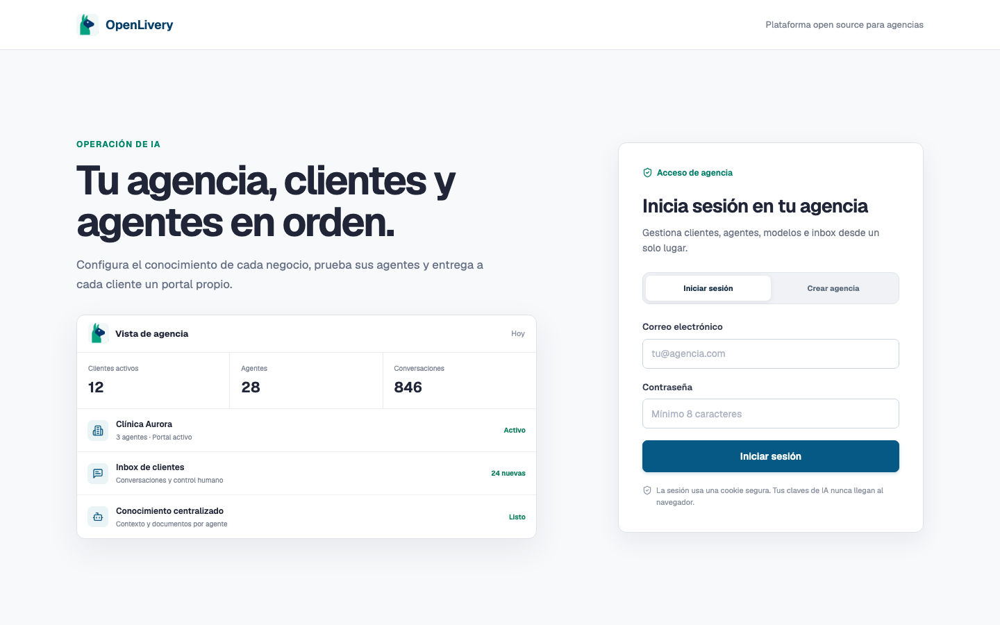
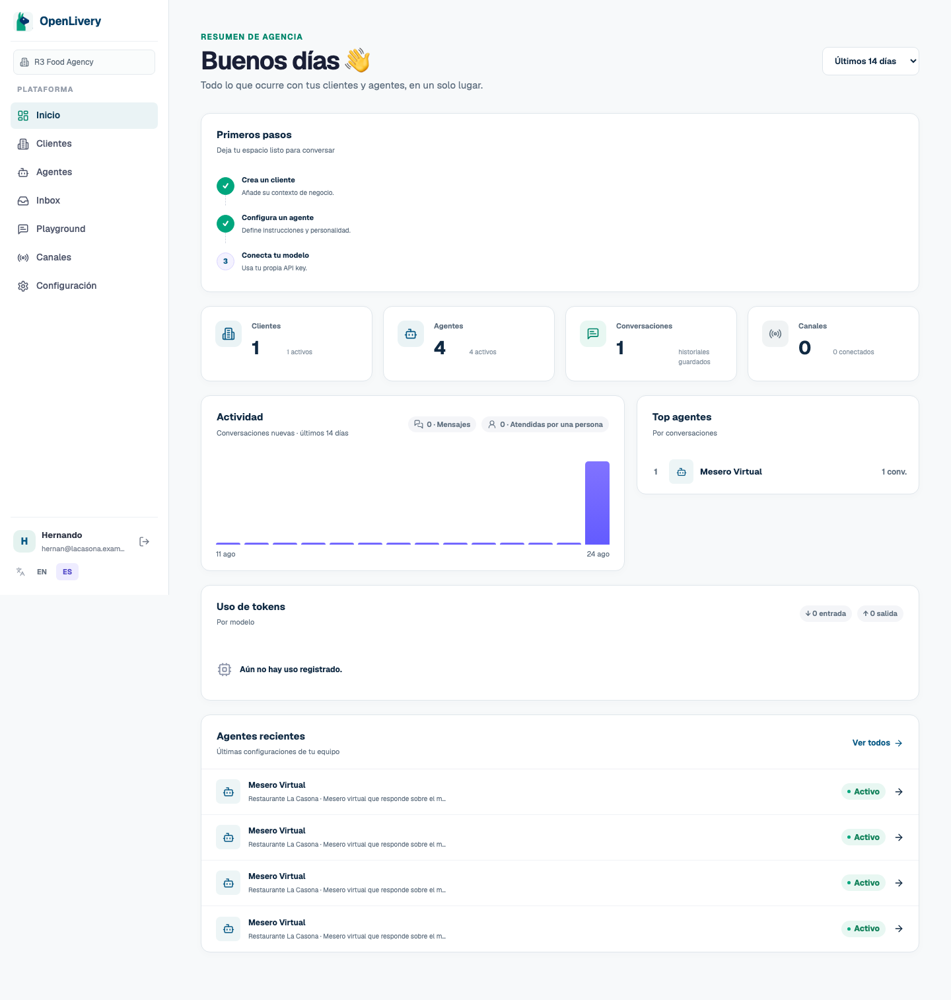
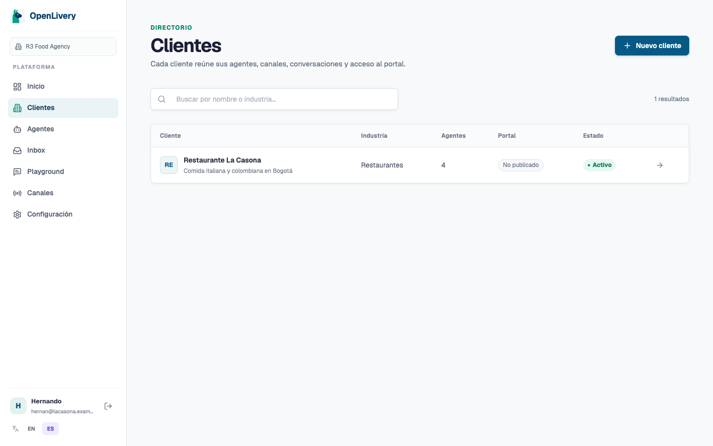
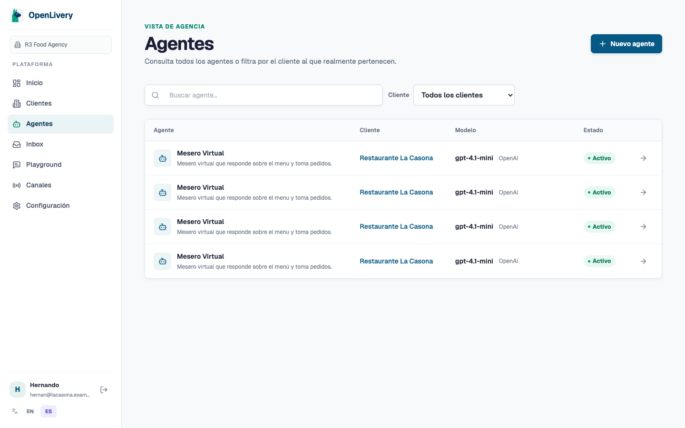
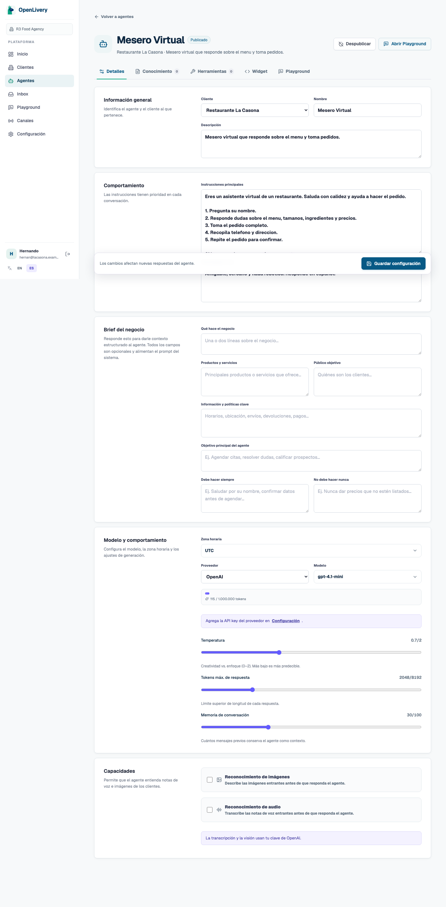
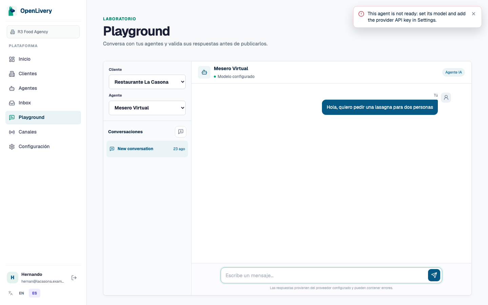
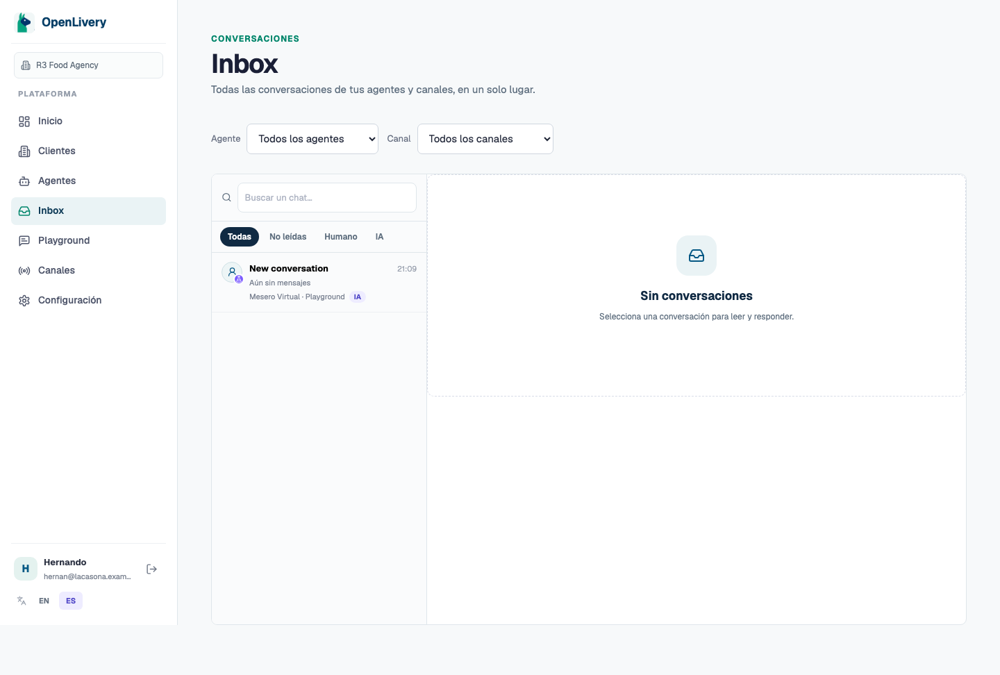
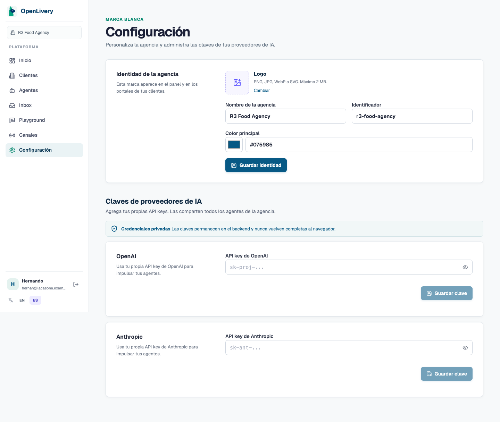
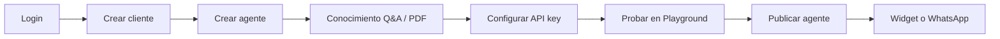

# Manual de usuario — OpenLivery (operador de agencia)

Guía para el equipo que opera la plataforma: crear clientes, configurar agentes de IA, probar conversaciones y atender el inbox.

> **Audiencia:** administradores y operadores de una agencia white-label.  
> **Instalación técnica:** ver [`self-hosting.md`](self-hosting.md).

---

## 1. Acceso e idioma

1. Abra la URL de su instancia (ej. `http://localhost:3000/login`).
2. Inicie sesión con email y contraseña de la agencia.
3. En la barra lateral inferior puede alternar **ES / EN**. La interfaz queda en español por defecto.

---

## 2. Panel de inicio

Tras el login verá el **Inicio** con:

- **Primeros pasos:** checklist de onboarding (cliente, agente, clave de proveedor).
- **Métricas:** clientes, agentes, conversaciones y canales conectados.
- **Actividad:** gráfico de conversaciones recientes y uso de tokens.
- **Agentes recientes:** acceso rápido a agentes activos.

---

## 3. Clientes

En **Clientes** administra las empresas finales (restaurantes, clínicas, etc.).

| Acción | Descripción |
| --- | --- |
| Crear cliente | Nombre, industria, contexto general del negocio |
| Activar / desactivar | Controla si el cliente aparece en selectores |
| Portal | Slug opcional para portal público del cliente |
| Canales | WhatsApp y WhatsApp Cloud por cliente |

---

## 4. Agentes

Cada agente pertenece a **un cliente** y define cómo responde la IA.

### 4.1 Listado

En **Agentes** ve todos los agentes, su cliente, modelo y estado (publicado / borrador).

### 4.2 Detalle del agente

Al abrir un agente, las pestañas principales son:

| Pestaña | Para qué sirve |
| --- | --- |
| **Detalles** | Instrucciones, personalidad, modelo, temperatura, memoria |
| **Conocimiento** | Contexto manual, pares Q&A y PDFs indexados |
| **Herramientas** | HTTP tools y servidores MCP |
| **Widget** | Código embebible y saludo del chat web |
| **Playground** | Prueba integrada del agente |

Acciones en la cabecera:

- **Publicar / Despublicar** — habilita el agente en canales públicos.
- **Abrir Playground** — prueba rápida de conversación.

---

## 5. Playground (laboratorio)

El **Playground** simula una conversación real sin depender de WhatsApp ni del widget.

1. Elija **Cliente** y **Agente** (si no llegó con `?agent=...` en la URL).
2. Cree una conversación con el botón **+** en la lista lateral.
3. Escriba un mensaje y envíe con Enter o el botón de envío.
4. Revise respuestas, fuentes citadas (knowledge) y modo IA / humano.

### Requisito para respuestas reales de IA

El agente debe tener **modelo configurado** y la agencia debe tener **API key del proveedor** guardada en Configuración.

Si falta la clave, verá un aviso como:

> *This agent is not ready: set its model and add the provider API key in Settings.*

En ese caso el mensaje del usuario se guarda, pero **no hay respuesta del modelo**.

---

## 6. Inbox

**Inbox** concentra conversaciones de todos los canales:

- Playground
- Widget embebido
- WhatsApp / WhatsApp Cloud

Desde aquí puede filtrar por canal, tomar conversaciones en modo humano y responder manualmente.

---

## 7. Configuración

### 7.1 Identidad de la agencia

Personalice logo, nombre, identificador (slug) y color principal para la marca blanca.

### 7.2 Claves de proveedores de IA

Aquí guarda las API keys de **OpenAI** y/o **Anthropic**. Son compartidas por todos los agentes de la agencia.

1. Pegue la clave (`sk-proj-...` o `sk-ant-...`).
2. Pulse **Guardar clave** (se valida contra el proveedor).
3. Vuelva al Playground y envíe un mensaje de prueba.

---

## 8. Flujo recomendado de puesta en marcha

1. Cliente con contexto del negocio (horarios, zonas, tono).
2. Agente con instrucciones claras y personalidad.
3. Base de conocimiento (menú, precios, políticas).
4. API key en Configuración.
5. Prueba en Playground.
6. Publicar y conectar canal (widget o WhatsApp).

---

## 9. Corrida real documentada (instancia local)

| Campo | Valor |
| --- | --- |
| Agente probado | Mesero Virtual |
| Modelo | gpt-4.1-mini (OpenAI) |
| Mensaje enviado | *Hola, quiero pedir una lasagna para dos personas* |
| API key configurada | No |
| Resultado | HTTP 400 — agente no listo sin clave de proveedor |

Detalle técnico de la corrida: [`manual-usuario/RESULTADO-CORRIDA.md`](manual-usuario/RESULTADO-CORRIDA.md).

Para completar la corrida con respuesta real de IA, agregue su clave OpenAI en **Configuración → OpenAI** y repita la prueba en Playground.

---

## 10. Documentación relacionada

| Recurso | Contenido |
| --- | --- |
| [`self-hosting.md`](self-hosting.md) | Docker, backups, HTTPS, WhatsApp |
| [`README.md`](../README.md) | Visión general del producto |
| https://openlivery.com/docs | Documentación oficial en línea |

---

*Capturas generadas automáticamente el 2026-08-23 contra `http://localhost:3000`.*
